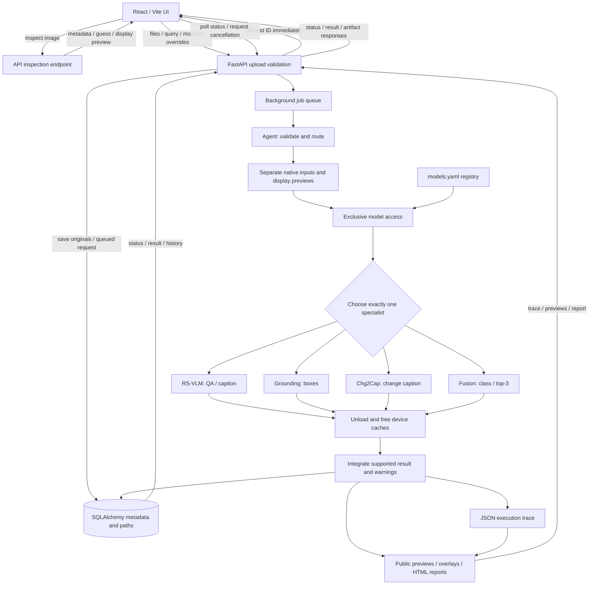

# Architecture

> Current mode update: all four adapters are configured real at the user’s request. Model 4 is not yet verified on a real pair; any older stub-only status below records the previous preparation phase. No benchmark or real-pair measurement is added by this mode switch.

SatQuery AI separates user interaction, request orchestration, model execution
and persistence. Its design deliberately selects one specialist per query;
it does not run an ensemble of every model. The stack and specialist contracts
come from [AGENTS.md](../AGENTS.md); actual paths and enabled modes come from
[backend/models.yaml](../backend/models.yaml).

## Layers

| Layer | Responsibilities | Main implementation |
|---|---|---|
| UI | Upload/inspect images, modality badges and overrides, query examples, polling, elapsed progress/cancel, answer/evidence, validation labels, warnings, history and trace/report downloads | `frontend/src/` |
| API | Multipart uploads, size/type checks, safe storage names, background-job endpoints, static PNG serving, CORS and report downloads | `backend/app/api/` |
| Agent | Validate inputs, apply routing rules, call preprocessing, invoke only the chosen specialist, integrate supported output and write the trace | `backend/app/agent/` |
| Preprocessing | Inspect imagery, guess modality with reasons, validate/prepare pairs, separate display previews from native arrays | `backend/app/preprocessing/` |
| Specialists | Common lifecycle/result contract, lazy real adapters, explicit stubs and registry-based selection | `backend/app/models/`, `backend/app/schemas/` |
| Storage | SQLite/SQLAlchemy request metadata and paths; disk files for uploads, previews, overlays, traces and reports | `backend/app/db/`, `uploads/`, `traces/`, `weights/` |

The API serves trace files through a dedicated endpoint, not the public image
mount. The diagram groups disk artifacts; raw images and weights are not exposed
through that static mount. The fusion branch is implemented but configured as a
real adapter, **not yet verified on a real pair**.

## Request flow

1. The UI calls `POST /api/inspect` for each selected file. The API reports band
   count, dimensions, dtype, georeferencing, value ranges and a modality guess.
   The guess is heuristic and the user can override it. The temporary inspection
   upload is removed after the response; its thumbnail is a display preview.
2. `POST /api/analyze` receives files, query and optional overrides. The API checks
   count, query, supported extensions/signatures and upload limits, saves safe
   filenames, persists a queued request and returns its ID immediately.
3. The worker marks the job running. The Agent inspects imagery, validates the
   combination and routes it. One optical image selects QA/caption or grounding;
   two optical images select change description; optical+SAR selects fusion;
   SAR-only and unsupported requests get a clear explanation. Caption terms take
   precedence over grounding terms, so “show me a summary” is a caption request.
   A query such as “where does the road go” selects boxes, not a trajectory model.
4. `prepare_for(model_id, inputs)` produces model-native NumPy arrays and notes,
   with separate display previews/native paths. Models convert arrays to Torch
   tensors internally. Models 1/2 use native RGB, Model 3 uses ordered normalized
   before/after RGB. Real fusion validates and normalizes original raw bands;
   it never consumes the RGB/SAR display PNGs or silently resamples its pair.
5. Under a process-wide lock, the registry instantiates the selected real adapter
   or stub. The Agent lazy-loads, runs it and unloads in cleanup. Real adapters
   release available device caches. The API uses one inference queue worker;
   the lock also serializes calls across Agent instances in the same process.
6. Integration attaches supported evidence, missing/uncalibrated confidence
   labels, registry validation status, domain warnings and a short summary. Change
   queries carry the description-only limitation. A before/after slider shows
   inputs, not a generated change map; fusion top-3 scores are not spatial evidence.
7. The Agent writes a JSON trace. The API publishes only prepared PNG artifacts,
   persists result/trace paths and exposes terminal status through polling. Loading,
   validation or inference failures are saved as failures with explanations; a
   requested real model that fails strict loading is not disguised as a stub success.

## Registry and specialist contract

Registry entries include `id`, `display_name`, `accepted_inputs`, `tasks`,
`output_type`, `version`, `weights_path`, `enabled`, `mode`, `preprocessing`,
`settings` and `validation_status`. Paths are relative to the repository root.
All four adapters are configured `real`; Model 4 remains unverified on a real pair. `/api/models` exposes configured and
effective mode plus `fallback_reason`; the actual result/trace records the adapter
version and mode that ran. A catalog value such as `stub-v1` is not a claim about
the recovered training checkpoint version.

The registry checks implementation availability, required weight paths/files
and ML modules when resolving real mode. Missing prerequisites yield a labelled
stub fallback. These checks do not certify learned-model quality or guarantee
that loading will succeed. Strict state-key/shape checks happen inside real
adapter loading. `enabled: false` rejects selection of that specialist.

Every specialist implements `load()`, `unload()`, `is_loaded` and
`run(inputs, query, options)`. The standard result is:

| Field | Meaning |
|---|---|
| `answer` | Text answer/caption or selected land-cover class |
| `evidence` | Grounding boxes/labels/scores, fusion top-3 classes, or `null` |
| `confidence` | `{value, calibrated, note}` when supported, otherwise `null` |
| `metadata` | Model name/version, runtime, device, parameters, actual mode, fallback reason, validation status, warnings and missing-confidence reason |

When confidence is absent, `metadata.confidence_reason` is `"not available"`.
Currently supplied confidence scores are uncalibrated. Grounding exposes per-box
scores and leaves aggregate answer confidence unavailable. Stubs use the same
shape but explicitly identify their synthetic outputs.

## Execution trace format

The trace lives at `traces/<request_id>.json` (or the configured trace directory).
It records execution facts and errors, not a private chain of thought.

| Key | Recorded content |
|---|---|
| `request_id`, `timestamp`, `query` | Request identity, UTC timestamp and original query |
| `validation` | Validity and inspected-image metadata; an input explanation/code on supported validation failures |
| `detected_modalities` | Original guess, chosen/overridden modality and heuristic reason |
| `routing` | Task, model ID, heuristic routing confidence and plain-language reasons, when a decision exists |
| `chosen_model` | Selected ID, configured mode, actual mode/version and fallback reason, when selected |
| `preprocessing_steps` | Operations, input order, native/display preparation, normalization and warnings |
| `parameters` | Effective request/model parameters |
| `runtime_ms`, `device` | Agent elapsed runtime and selected device when available; not just browser polling time |
| `lifecycle` | Exclusive-lock, loaded and unloaded state, when model execution was entered |
| `output` | Agent response including success/result, routing, warnings, explanation/error and summary |
| `warnings`, `errors` | Domain/support caveats and stage/type/message for failures |
| `cancelled` | Whether the Agent observed cooperative cancellation |
| `api_artifacts` | Paths of API-published previews and evidence overlays, attached by the worker |

Fields can be absent or null if execution stops before that stage. Trace writes
use a temporary file followed by replacement. An unexpected API-worker failure
also attempts to persist a terminal state and error trace. Trace data includes
queries and local paths; treat it as local request data when sharing reports.

## Jobs, persistence and API surface

Job states are `queued`, `running`, `done`, `failed` and `cancelled`. Status also
exposes progress messages, elapsed time and cancellation intent. Cancellation
is cooperative between operations; an active load/download/inference operation
can finish before unloading. Intent is persisted for restart recovery. Queued
cancellation is handled when the worker dequeues that request, not by interrupting
another active model.

| API | Purpose |
|---|---|
| `POST /api/inspect` | Image metadata, modality guess and thumbnail |
| `POST /api/analyze` | Queue analysis; return request ID |
| `GET /api/requests/{id}` | Status, supported result, routing, artifacts and warnings |
| `GET /api/requests` | Paginated history |
| `POST /api/requests/{id}/cancel` | Cooperative cancellation |
| `GET /api/traces/{id}` | Saved execution trace |
| `GET /api/models` | Registry/effective mode and validation information |
| `GET /api/health` | Database and worker availability; not model-quality validation |
| `GET /api/assets/...` | Published PNG previews/overlays only |
| `GET /api/report/{id}` | Self-contained HTML report; path saved in the database |

SQLAlchemy tables store requests, upload paths/metadata, trace paths/key fields,
results/report paths/structured output, and the core registry catalog. The catalog
is synchronized at startup; YAML remains the configuration authority. Raw image
bytes and model weights are not stored in database rows. Upload retention removes
expired request image artifacts; history and traces survive that cleanup.

Configure `DATABASE_URL`, `SATQUERY_STORAGE_DIR`, `SATQUERY_TRACE_DIR`,
`SATQUERY_MAX_UPLOAD_BYTES`, `SATQUERY_MAX_REQUEST_BYTES`,
`SATQUERY_RETENTION_HOURS`, `SATQUERY_CLEANUP_INTERVAL_SECONDS` and
`SATQUERY_CORS_ORIGINS` for deployment. PostgreSQL driver/deployment validation,
authentication and production hardening guidance: **to be added**. A process-wide
lock does not coordinate multiple server processes; this demo should run one API
worker rather than parallel inference servers.

## Portability and optional playback

`SATQUERY_MODELS_CONFIG`, per-model path/mode overrides and `SATQUERY_DEVICE`
configure the existing registry without changing its fields. `.env` is optional
and ignored; shell environment wins. `SATQUERY_RETENTION_DAYS` converts to the
existing retention-hours setting. The PostgreSQL switch test isolates tests in
temporary schemas; see [postgres_check.md](postgres_check.md).

With `DEMO_MODE=true`, a local catalogue is matched against exact file hashes,
ordered modalities, stripped query, model and task after validation/preparation.
A match bypasses model construction/loading. `metadata.execution_type`, the API
status response and top-level trace `execution_type` explicitly say `pre-computed`;
`demo_info` records entry ID, recording time, source device/runtime and placeholder
status. Playback has a no-model-loaded lifecycle record. UI/history/report labels
follow this execution type, not the source model's original stub/real field.
Unmatched requests keep the normal route. Fusion entries are accepted only as
explicit placeholders while real pairs remain absent. Live real fusion later
retains its strict native input validation. No unsafe inference timeout is used.

The nginx frontend container serves a production Vite build and proxies the API.
FastAPI can alternatively serve only the built frontend directory when
`SATQUERY_STATIC_DIR` is set. Local Compose volumes hold data/cache; weights and
model config are read-only mounts, never baked into images. No public deployment
is performed by the local launcher, Compose checks or PostgreSQL test script.
